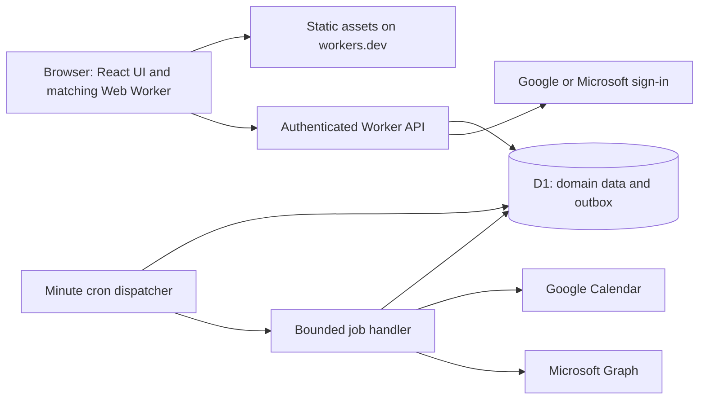

# Implementation plan: free private-group Schedule Tracker

Date: 10 October 2026  
Status: Owner-only v0.1 manual-planning preview deployed on 15 October 2026 with Google identity. The owner confirmed real Google sign-in on 15 October 2026; full-plan acceptance remains open. Google Calendar and Microsoft integrations are deferred by user instruction. See [implementation status](../docs/implementation-status.md) and [release notes](../docs/release.md).  
Source: [SRS](../SRS.md) · [Execution checklist](todo.md) · [Architecture decision](../docs/decisions/001-free-private-deployment.md)

## 1. Recommendation and feasibility

**v0.1 preview — 15 October 2026:** User approved releasing Google sign-in plus manual planning now, with Google Calendar sync later. The owner-only preview has been deployed; see [release evidence](../docs/release.md). This supersedes the initial calendar gate for this limited preview only. It does not mark the full SRS, operational acceptance or broader member release complete.

**Scope update — 15 October 2026:** At the user's explicit request, the initial release uses Google sign-in and Google Calendar only. Microsoft sign-in and calendar integration are deferred to a later phase and do not block this release. Microsoft-specific sections below retain future requirements, not current gates. Google OAuth, private identity, Free-plan verification, runtime measurements and other release checks remain required.

Build a React + TypeScript website with a small Cloudflare Worker API, Cloudflare D1 database, and one scheduled Worker job. Deploy to the included HTTPS workers.dev address. Build locally and upload with Wrangler so paid build services are unnecessary. Cloudflare documents this address as suitable for personal/hobby projects, matching the user's confirmed small private group with no domain. [Hosting address](https://developers.cloudflare.com/workers/configuration/routing/workers-dev/), [React deployment guide](https://developers.cloudflare.com/workers/framework-guides/web-apps/react/).

**A $0/month private deployment is technically feasible within the documented free allowances.** This is a capacity-based assessment, not a claim that a deployment has already been tested. Initial engineering must prove OAuth account setup, real provider calls, and execution within free runtime limits. Neither unlimited growth nor the full SRS service targets can be guaranteed at zero cost.

The initial operating envelope is a proposed cap of **20 personally known members, 40 connected calendars total, and 100 future plans**. These are application controls, not hosting-provider limits. The twelve-month planning horizon is retained. The 50-person matching scenario remains a synthetic benchmark; it does not imply a 50-person launch group.

## 2. Confirmed constraints and SRS reconciliation

Confirmed by the user: free deployment; small private group; no existing domain. The SRS remains the baseline; this plan records proposed release differences explicitly rather than silently rewriting it.

| SRS area | Private release decision |
|---|---|
| AC-01 accounts | Google or Microsoft sign-in with an invite allowlist. No local passwords or password-reset email service; account recovery initially belongs to the identity provider. Calendar access is separate consent. |
| PL-03/04, visitor role, public discovery | Release 1 permits Group-only and Invite-only plans. Public publishing/discovery is deferred until an explicit public-launch decision. Joining within the private group remains fully supported. |
| NT-02 optional email | Use in-app notifications and reminders only initially. Email configuration is deferred; do not present a nonfunctional email toggle. In-app reminders are stored while offline but do not notify a closed browser. |
| AV/MT long-term scheduling | Keep twelve months; compute views and matching in chunks. Unknown and stale data remain explicit. |
| NF-01/02 load/latency | Measure the SRS benchmarks. Launch capacity is lower than 100 concurrent users; record any failed benchmark as a release exception. |
| NF-03 60-second export / 15-minute import | Retain as targets under healthy services; expose delayed states. A minute cron is not a hard delivery guarantee. |
| NF-04 availability | Treat 99.5% as an observed objective, not a free-hosting SLA. |
| NF-10 backup | Use D1's seven-day free point-in-time recovery and a tested restore runbook. Recovery targets require a drill. Seven-day backup history is consistent with deletion by ninety days, but provides less history than a long archival backup. |
| MD-01 reports/moderation | Keep member reporting, blocking, account suspension, and organizer notices inside the private application. Public-content moderation is deferred with public discovery. |

Review these differences as part of the implementation handoff. Do not report full original-SRS conformance until deferred requirements are implemented or explicitly rebaselined.

## 3. Verified free-service budget

Documentation checked 10 October 2026. Recheck before provisioning because vendor terms can change.

| Component | Choice | Documented allowance / constraint | Planned cost |
|---|---|---|---|
| UI hosting | Workers Static Assets | Static-asset requests are free and unlimited when served directly | $0 |
| API | Workers Free | 100,000 requests/day; 10 ms CPU per invocation | $0 |
| Scheduler | Worker Cron Trigger | Free-plan CPU limit also applies to scheduled invocations; use one minute-based trigger | $0 |
| Database | D1 Free | 5 million rows read/day; 100,000 rows written/day; 500 MB per database; 5 GB across account | $0 |
| Recovery | D1 Time Travel | Seven-day recovery window on Free | $0 |
| Address | Included workers.dev | No domain purchase required for private hobby use | $0 |
| Calendar APIs | Google Calendar + Microsoft Graph calendar endpoints | Google standard use has no additional cost. Calendar endpoints are not listed among Graph metered APIs; users still need eligible calendars and permission to connect | $0 API usage expected |
| Build/deploy | Local Node toolchain + Wrangler | Runs on the existing developer computer; no hosted CI requirement | $0 incremental hosting |
| Notifications | Database-backed in-app inbox | Included in Worker/D1 consumption | $0 |

Sources: [Workers pricing](https://developers.cloudflare.com/workers/platform/pricing/), [Workers limits](https://developers.cloudflare.com/workers/platform/limits/), [D1 pricing](https://developers.cloudflare.com/d1/platform/pricing/), [D1 limits](https://developers.cloudflare.com/d1/platform/limits/), [Time Travel](https://developers.cloudflare.com/d1/reference/time-travel/), [Google quotas and cost](https://developers.google.com/workspace/calendar/api/guides/quota), [Graph metered APIs](https://learn.microsoft.com/en-us/graph/metered-api-list).

Google Workspace or Microsoft 365 subscriptions, if a member already uses them, are not supplied by this app. Personal-calendar support avoids requiring all members to purchase such subscriptions. Existing internet, computer, and electricity costs are outside hosting cost.

### 3.1 Workload estimate and hard controls

Engineering estimate, not measured usage:

- 20 members × 150 dynamic requests/day = 3,000 requests/day.
- A one-minute dispatcher adds 1,440 invocations/day. Allow another 15,000/day for bounded jobs, OAuth callbacks, retries, and synchronization overhead: approximately 19,440/day, below the 100,000 allowance.
- 40 calendars × 96 refresh opportunities/day = 3,840 calendar refresh opportunities/day. Pagination and twelve-month expansion multiply provider calls; these are not assumed to be one-call refreshes.
- Target under 50,000 billed D1 writes/day and 1 million rows read/day. Changed-row upserts are essential; replacing every imported interval every fifteen minutes would exhaust the free tier. D1 index maintenance also counts as writes.
- Store only required calendar metadata and compact intervals. A rough 80,000 intervals × 500 bytes is 40 MB before indexes, plans, sessions, and logs; measure actual database growth. Warn at 250 MB and stop adding connections at 350 MB, leaving headroom below 500 MB.
- Initial import is resumable and paginated. Unscanned date ranges stay Unknown. Apply per-member/calendar daily work limits and a global job budget; report partial coverage rather than quietly asserting availability.

Expose usage and queue age in the admin dashboard. Warn at 50% and 75% of daily request/read/write allowances. At 80%, defer nonessential refreshes, restrict new bulk operations, and preserve jobs for retry. At provider-enforced limits, operations can fail until quota reset; show a maintenance state. Do not upgrade plans, add paid resources, or hide stale data automatically. Growth requires reducing workload, keeping admission capped, or a new user decision.

## 4. Architecture



Use one codebase and one deployment initially. Authenticated job dispatch may use an internal service binding to a bounded handler if profiling shows a scheduled invocation cannot fit the work; account for all invocations and never expose an unauthenticated job URL. Prefer a small amount of useful work per invocation with persisted continuation over large in-memory loops.

### 4.1 Stack

- Frontend: React, TypeScript, Vite, plain responsive CSS; client-side routing. Pin supported dependency versions and audit licenses during bootstrap.
- Backend: TypeScript Worker using Web APIs, small route modules, shared request/response schemas, and explicit access-policy functions.
- Data: D1 with SQL migrations and prepared statements. Avoid adding an ORM before it is needed.
- Authentication: standards-based OAuth/OIDC library compatible with Workers, selected and pinned in the authentication spike. Do not implement token signature validation or OAuth protocol machinery from scratch.
- Tests: Vitest for domain/Worker integration tests, Playwright for browser flows, and an accessibility checker. Validate exact package compatibility at bootstrap.
- Time handling: an IANA-aware date-time library and bounded weekly-rule expansion. Pin and test the library against DST fixtures. Annual UI aggregation and large matching computations run in a browser Web Worker using only data the member may access.

This project does not require Python despite its parent folder name. TypeScript shares domain types between UI and API and fits the selected runtime. The [official Cloudflare React/Vite guide](https://developers.cloudflare.com/workers/framework-guides/web-apps/react/) establishes the deployment path.

### 4.2 Data and consistency

Add schema incrementally with each user flow: users, identities, sessions, invitations, groups, memberships, sharing grants, availability rules/exceptions, plans, candidates/votes, participation, calendar connections, busy intervals/coverage, exports, outbox jobs, notifications, reports, and audit events.

Essential invariants:

- Unique identity by provider + issuer + subject, not email. Link another identity only from a freshly authenticated session; never auto-merge accounts by matching email.
- Unique membership per group/user; unique participation per plan/user; unique export per plan/user/destination generation.
- All capacity-changing operations use a database-enforced atomic transition: a guarded SQL mutation plus transactional batch/trigger that updates participation and held-seat count together. Do not read capacity in JavaScript and later insert. Validate D1 semantics with contention tests before adopting the SQL pattern. [D1 batch API](https://developers.cloudflare.com/d1/worker-api/d1-database/).
- Plan version increments and outbox insertion commit together. Jobs re-read the latest desired version so late responses cannot overwrite newer plans.
- Job claims use leases and compare-and-swap state changes. Jobs remain recoverable after runtime termination. Retries use deterministic identifiers and provider reconciliation.
- Every private query filters by actor access. Never ship private event descriptions to the browser or put calendar credentials in browser storage.
- Store provider credentials encrypted with a versioned key held in Worker secrets. Redact credentials, codes, and event details from logs. Implement rotation and token-refresh concurrency protection.
- API sessions use opaque random tokens, hashed server-side, in Secure/HttpOnly/SameSite cookies. Check Origin/CSRF protection on mutations. Use short-lived, single-use OAuth state and PKCE where supported, strict redirects, nonce/issuer/audience validation, and session rotation on sign-in.

### 4.3 Availability computation

Normalize intervals into UTC instants with source IANA zones. Preserve weekly rules in local time. Use half-open intervals, apply the SRS precedence rules, and exclude the plan being rescheduled and its managed calendar copies.

Return authorized availability in paginated date windows with explicit coverage/freshness. Expand recurring rules and calculate 90-day/annual suggestions in a cancellable browser Web Worker. The API remains responsible for input validation, permissions, state transitions, and rechecking the selected interval before confirmation. It must not trust a browser's claim that a slot is conflict-free.

Use bounded provider windows and incremental updates where supported. If a provider requires a larger read scope to identify managed copies or detect external edits, request it only for that feature and explain it. No event details are retained beyond the required normalized fields.

### 4.4 API boundaries

Proposed route families: /api/session, /api/profile, /api/groups, /api/availability, /api/plans, /api/plans/:id/participation, /api/plans/:id/votes, /api/calendar-connections, /api/calendar-exports, /api/notifications, and /api/admin.

Commands accept expected plan versions and idempotency keys where applicable. Responses distinguish validation errors, unauthorized access, stale version, capacity exhausted, throttling, and asynchronous work pending. Private responses use no-store. Provider callback routes have OAuth protections rather than assuming an existing session is sufficient.

## 5. Calendar authorization: resolve before building everything

### 5.1 Google

Google documents a verification exception for an app used by a few people personally known to its developer. This is the proposed private-group route, subject to confirming the actual consent configuration. An unverified-app warning and user cap remain. This exception must not be used to operate an open public service. [Personal-use exception](https://developers.google.com/identity/protocols/oauth2/production-readiness/brand-verification).

Start development with named test accounts. Calendar refresh tokens issued under External/Testing expire after seven days. For ongoing private use, validate the personal-use exception with a production-status OAuth configuration; published/unverified apps still have a 100-user cap and warnings. Do not treat tokens as permanent or bypass organization policy. If the exception/configuration is unavailable, the zero-cost fallback is named testers with explicit reconnection, a degraded operational mode requiring disclosure. [OAuth states](https://developers.google.com/identity/protocols/oauth2/production-readiness/overview), [Token expiration](https://developers.google.com/identity/protocols/oauth2).

Register the exact stable HTTPS callback address. Prototype workers.dev acceptance in the actual Google console before committing to it. Public verified launch later requires domain-ownership review; a free hosting address is not proof of ownership of workers.dev. [Production policy](https://developers.google.com/identity/protocols/oauth2/production-readiness/policy-compliance).

Request identity scopes only for sign-in. Candidate calendar scopes are calendar.calendarlist.readonly for selection, calendar.events.readonly for minimal event metadata/managed-copy reconciliation, and calendar.events.owned for writing to an owned calendar. Recheck endpoint compatibility and the scope labels in the console. Use an owned writable destination in release 1; shared-calendar writing is not promised. A free/busy-only option can use a narrower scope but cannot silently claim all event-reconciliation capabilities. [Calendar scopes](https://developers.google.com/workspace/calendar/api/auth).

Use explicit field selection, bounded event reads, stable provider event IDs, and a private ownership marker. Before mutating/deleting an event, verify its persisted mapping and marker. Use documented deterministic insert IDs to reconcile a successful insert whose response was lost. [Events list](https://developers.google.com/workspace/calendar/api/v3/reference/events/list), [Events insert](https://developers.google.com/workspace/calendar/api/v3/reference/events/insert).

### 5.2 Microsoft

Register for both personal Microsoft accounts and organizational accounts if the group's needs require both. Microsoft documents an Azure account/subscription, tenant, and app-registration permissions as setup prerequisites. Check the user's ability to obtain these at zero incremental cost in Task 01; do not assume that having an Outlook mailbox alone provides registration rights, or promise card-free setup. Do not provision paid Azure compute. [Registration prerequisites](https://learn.microsoft.com/en-us/entra/identity-platform/quickstart-register-app).

Use delegated calendar access, with offline_access for background refresh. Start reads with Calendars.ReadBasic where sufficient; request Calendars.ReadWrite separately when enabling export. Query each consenting member's calendarView; this endpoint documents personal-account support. Do not base personal-calendar support on an organization-only scheduling endpoint. [calendarView](https://learn.microsoft.com/en-us/graph/api/calendar-list-calendarview?view=graph-rest-1.0).

Use transactionId on event creation and a stored external ID/ownership marker, then test retry behavior, updates, and deletion. Organization administrators may block consent; display the restriction rather than suggesting a bypass. Standard calendar endpoints are outside the current metered API list; enterprise mailbox licenses remain the member's responsibility. [Create event](https://learn.microsoft.com/en-us/graph/api/calendar-post-events?view=graph-rest-1.0), [Metered list](https://learn.microsoft.com/en-us/graph/metered-api-list).

### 5.3 Durable processing

The database outbox is the source of pending work. Attempt small exports immediately after commit when possible; cron recovers unfinished jobs. Process one provider page or bounded operation per job. Respect Retry-After, back off on temporary failures, stop on revoked credentials, and expose the last success and coverage range.

Prioritize membership/cancellation exports, then reconfirmation updates, reminders, and busy imports. Use a maximum age and attempts before surfacing failure. Never treat waitUntil alone as a durable queue. Large fan-out creates per-participant jobs. A material plan change invalidates obsolete reminders. Externally deleted copies remain marked missing until explicit user resync.

Poll at a bounded cadence for the private release; provider webhooks are a later optimization unless measurements show polling cannot meet the budget. Twelve-month freshness must be measured with realistic recurring calendars. If fifteen-minute full-horizon freshness exceeds quotas, report an NF-03 exception; do not quietly reduce the horizon or mark unrefreshed months free.

## 6. Delivery sequence and verification gates

The detailed, ordered task list is [todo.md](todo.md). Each task is a focused slice with acceptance criteria, verification, dependencies, and likely files. It is the single checkbox source of truth.

| Stage | Tasks | User-visible outcome / gate |
|---|---|---|
| Feasibility | 01–06 | Accounts/setup validated, minimal free deployment, OAuth and runtime measurements; revise architecture early if any gate fails |
| Identity and availability | 07–15 | Invited member signs in, shares availability, sees long-term views, finds a time |
| Plans and membership | 16–24 | Create a plan, vote, join, leave, approve, waitlist, reconfirm, cancel |
| Calendars | 25–30 | Independently connect providers, export without duplicates, refresh availability, recover failures |
| Operations | 31–36 | In-app inbox/reminders, reporting, deletion, usage controls, restore procedure |
| Release | 37–39 | Full scenario verification, documented exceptions, private deployment and smoke test |

Checkpoint after every three tasks: focused tests and build pass; demonstrate the new flow; review any scope/cost change. A failed feasibility gate prevents claiming that the complete private app is deployable for free. Manual availability development can continue independently, but calendar integration remains an explicit unresolved requirement until proven.

## 7. Proposed repository and commands

```text
src/web/                 React screens, styles, browser matching worker
src/server/              Worker entry, routes, auth, repositories, jobs
src/domain/              intervals, recurrence, participation, permissions
src/providers/           Google and Microsoft adapters
migrations/             numbered D1 SQL migrations
tests/unit/             domain tests
tests/integration/      Worker/D1/provider-mock tests
tests/e2e/              Playwright scenarios
docs/                   setup, provider evidence, operating runbook, ADRs
tasks/                  this plan and checklist
```

Commands below are a proposed package-script contract to create during bootstrap; they do not exist yet:

```text
npm ci
npm run dev
npm run typecheck
npm run lint
npm run test -- --run
npm run test:integration
npm run test:e2e
npm run build
npm run deploy:dry-run
npm run db:migrate:local
npm run db:migrate:staging
npm run deploy:staging
npm run db:migrate:production
npm run deploy:production
```

Local development must use local D1 and provider mocks by default. Staging uses separate synthetic data and OAuth clients. Stable callback URLs must not change per preview build. Secrets stay in ignored local files or Cloudflare secrets; never in Vite public environment variables.

## 8. Deployment and rollback runbook outline

1. Validate Cloudflare Free plan, Google project, and Microsoft registration prerequisites. Record account ownership and recovery contacts without copying credentials into docs.
2. Reserve the stable workers.dev deployment names. Publish minimal homepage/privacy/terms pages explaining personal use and retained calendar data.
3. Create separate staging/production D1 databases and bindings, add secrets through the provider's secure interface, and keep API handlers in front of all private data.
4. Build and run local checks; apply staging migrations; deploy staging from the local machine. Use synthetic accounts for provider tests.
5. Measure real Worker CPU, D1 rows read/written, pagination, and queue age against the free-tier budget. Validate the exact Google consent flow and Microsoft personal/organizational behavior.
6. Before first private release, reconcile SRS exceptions and confirm the group allowlist. Apply additive production migrations, deploy, and run the end-to-end smoke test: join → export → reschedule → reconfirm → cancel.
7. Record release version, migration version, recovery bookmark, budget readings, known limitations, and rollback procedure. Roll back code to the previous compatible version; use database restoration only with an explicit recovery decision because it can discard new member actions.
8. After restore, invalidate resurrected sessions/tokens as needed, replay pending deletions, and reconcile managed calendar events against desired state. Restoring D1 does not roll back Google/Microsoft events.

Do not put the whole domain behind an authentication proxy that blocks OAuth callbacks or public policy pages. The application allowlist protects user data. A public URL is compatible with private membership.

## 9. Release definition of done

- All enabled-scope SRS functional requirements have linked tests; AT-01 through AT-13 pass where applicable. Explicitly record the public-discovery/email differences.
- Core happy paths and failure paths have runtime evidence, including privacy revocation, two simultaneous last-seat joins, DST, token revocation, duplicate job delivery, externally deleted copies, and stale imports.
- Focused tests, type checks, lint, production build, browser accessibility, and quota/CPU measurements pass. No test is treated as executed merely because it is listed here.
- Log redaction, session protection, object-level permissions, OAuth state checks, encrypted tokens, and account deletion are verified.
- A restore drill demonstrates recovery timing and post-restore calendar reconciliation. Operational instructions and user-facing limitations are accurate.
- No paid product or resource was enabled; admission/workload limits are active. Pricing is rechecked and remaining external-account blockers are recorded.

## 10. Risks and unresolved items

| Risk | Response / evidence required |
|---|---|
| 10 ms CPU is tight for OAuth, JSON, recurrence | Benchmark on deployed Free runtime in feasibility stage; use minimal payloads, small jobs, browser computation, and library profiling. If still over, revise the design before proceeding; do not quietly upgrade. |
| Google private exception or callback configuration unavailable | Real console/callback test first. Testing-mode reconnection is a documented degraded option, not an equivalent uninterrupted service. |
| Microsoft registration prerequisites unavailable | Resolve account/tenant setup first. If a zero-cost registration path cannot be obtained, full Microsoft integration is blocked; calendar-file export is only a partial fallback. |
| Busy imports exceed write/read budget | Incremental changed-row persistence, source coverage tracking, indexed reads, admission limits, and quota telemetry. |
| Free limits interrupt service | Reserve headroom, show maintenance/delays, and persist outstanding jobs. No promise of free-tier SLA. |
| Small private group later becomes public | Revisit Google verification/domain ownership, moderation, capacity, and spending before enabling public discovery. |

Still needed during implementation: actual member count (20 is only a proposed cap), account registration access, whether members use organizational calendars, and measured feasibility results. These do not prevent completing this plan.

